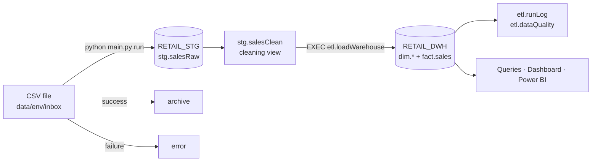
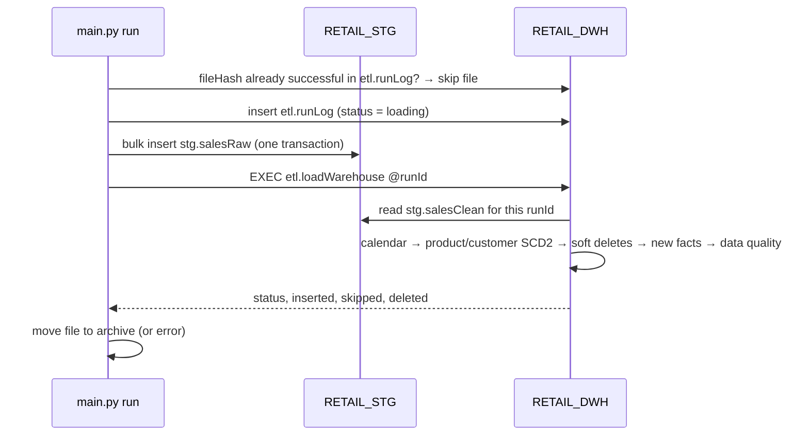
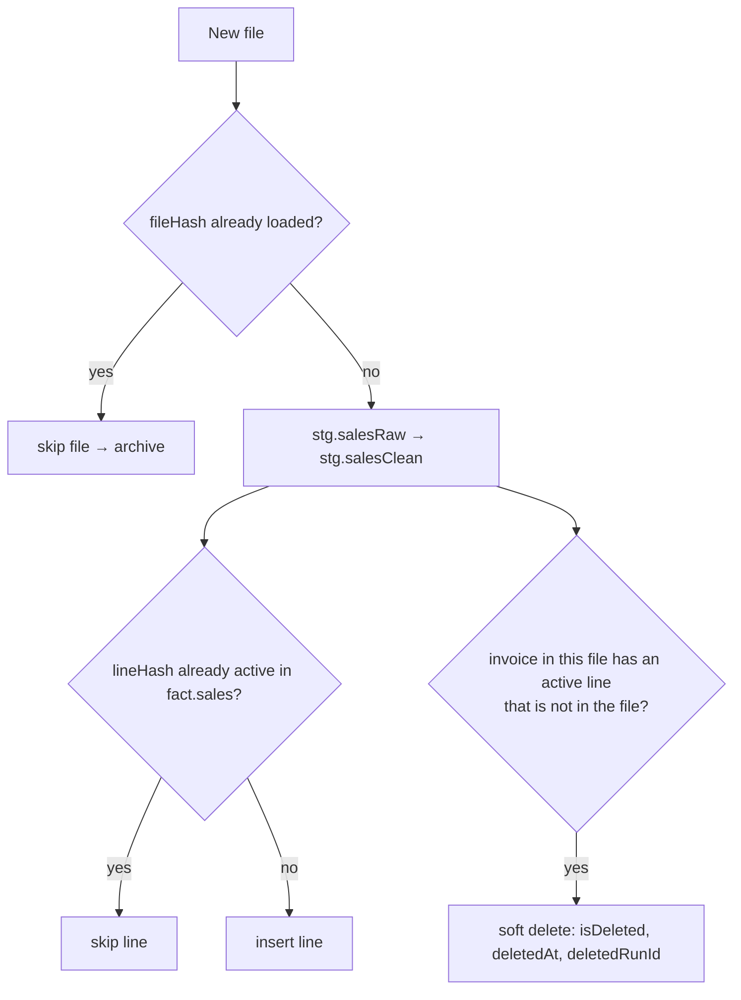

# RetailCo Sales Data Platform

**Live website: [retailcoo.netlify.app](https://retailcoo.netlify.app/)** · SQL Server 2025 · T-SQL · Python 3.14 · Streamlit

An incremental, auditable ETL pipeline. It ingests RetailCo's nightly sales export into a staging database (`RETAIL_STG`) and models it into a star-schema data warehouse (`RETAIL_DWH`) for reporting. It is built to be small, safe to re-run, and easy to hand over.

| Property | How it is achieved |
|---|---|
| **Idempotent** | file-level hash + line-level hash; re-running any file inserts nothing |
| **Incremental** | one file = one run; nothing is truncated or rebuilt |
| **Historised** | SCD type 2 on product and customer; facts link to the version valid at invoice time |
| **Auditable** | raw file kept as received; soft deletes; `runId` and timestamps on every row |
| **Atomic** | each load is a single transaction; a failure leaves the warehouse unchanged |
| **Observable** | `etl.runLog` and `etl.dataQuality` record every run and every data issue |


**Deliverables:**
- Website: [retailcoo.netlify.app](https://retailcoo.netlify.app/) (source: [`website/index.html`](website/index.html))
- Stakeholder report: [`docs/retail_data_platform_report.docx`](docs/retail_data_platform_report.docx)
- Interactive dashboard: `streamlit run dashboard/streamlit_app.py`

---

## Contents

1. [Overview](#1-overview)
2. [Architecture](#2-architecture)
3. [Quick start](#3-quick-start)
4. [Configuration](#4-configuration)
5. [Data model](#5-data-model)
6. [Load semantics](#6-load-semantics)
7. [Data quality](#7-data-quality)
8. [Operations and monitoring](#8-operations-and-monitoring)
9. [Analytics: queries, dashboard, website](#9-analytics-queries-dashboard-website)
10. [Testing](#10-testing)
11. [Design Q&A](#11-design-qa)
12. [Repository layout](#12-repository-layout)
13. [Data source](#13-data-source)

---

## 1. Overview

RetailCo, a UK online gift retailer, exports the previous day's orders, cancellations and adjustments as a CSV file every night. The raw files contain duplicates, guest orders, cancellations, non-product lines and inconsistent text, so reports built directly on them disagree. This platform turns each file into a single trusted model.

| Metric (full source file) | Value |
|---|---|
| Rows received | 541,909 |
| Sales lines in the warehouse | 536,641 (5,268 exact duplicates removed) |
| Net sales | £9,771,318.16 (gross £10,247,219.32 − cancellations £475,901.16) |
| Orders · customers · products · countries | 19,773 · 4,372 · 3,958 · 38 |
| Period | 1 Dec 2010 – 9 Dec 2011 |
| Full load time | ~30 s on a laptop |

---

## 2. Architecture




**Separation of concerns:**

| Component | Responsibility | Never does |
|---|---|---|
| `etl/pipeline.py` (Python) | finds files, checks the hash, bulk-inserts into staging, calls the procedure, moves the file | any cleaning or business logic |
| `RETAIL_STG.stg.salesRaw` | the file exactly as received (all text) | changes after loading |
| `RETAIL_STG.stg.salesClean` | **all** cleaning and classification rules, in one view | stores data |
| `RETAIL_DWH.etl.loadWarehouse` | dimensions (SCD2), facts (insert/skip/soft-delete), data quality, run status | truncates or hard-deletes |

**One nightly run:**



---

## 3. Quick start

**Prerequisites:**
- SQL Server 2022 or later (the code uses `GENERATE_SERIES` and `GREATEST`)
- ODBC Driver 18 for SQL Server
- Python 3.11 or later

```powershell
pip install -r requirements.txt
python main.py setup        # once: creates RETAIL_STG, RETAIL_DWH, tables, view, procedure
python main.py extract      # download the source CSV into the inbox
python main.py run          # inbox → RETAIL_STG → RETAIL_DWH → archive
python main.py report       # business queries → output/report_dev.md
streamlit run dashboard/streamlit_app.py   # dashboard → http://localhost:8501
```

**Daily operation:**
1. Drop the new file into `data/dev/inbox/`.
2. Run `python main.py run`. The exit code is `1` if any file failed, so a scheduler can alert on it.

---

## 4. Configuration

All settings live in `.config/`. Database names are the same in every environment; only the server, login and folders change.

| File | Purpose |
|---|---|
| `settings.env` | `ENVIRONMENT=dev` – default environment |
| `dev.env` | `SQL_SERVER=GHOST`, login, `data/dev/` folders |
| `prod.env` | production server, login, `data/prod/` folders |
| `example.env` | template for a new environment |

- **Switching environment:** use `--env prod` on any command, or change `settings.env`.
- **Authentication:** Windows authentication by default (`SQL_LOGIN=windows`), so no secrets are stored. For SQL logins, `SQL_PASSWORD` can be supplied as an environment variable.
- **Git:** `.config/*.env` files are git-ignored; only `example.env` is tracked.

---

## 5. Data model


| Object | Type | Grain (one row = …) | Key |
|---|---|---|---|
| `RETAIL_STG.stg.salesRaw` | table | one line of one delivered file | `runId`, `lineNumber` |
| `RETAIL_STG.stg.salesClean` | view | same as salesRaw, cleaned and classified | – |
| `RETAIL_DWH.fact.sales` | fact | one invoice line | `salesKey`; `lineHash` unique among active rows |
| `RETAIL_DWH.dim.calendar` | dimension | one day | `calendarKey` (YYYYMMDD) |
| `RETAIL_DWH.dim.product` | dimension, SCD2 | one product version | `productKey`; business key `stockCode` |
| `RETAIL_DWH.dim.customer` | dimension, SCD2 | one customer version (key 0 = guest) | `customerKey`; business key `customerId` |
| `RETAIL_DWH.etl.runLog` | control | one processed file | `runId` |
| `RETAIL_DWH.etl.dataQuality` | control | one check per run | `runId`, `checkName` |
| `RETAIL_DWH.etl.loadWarehouse` | procedure | loads one `runId` | – |

**`fact.sales` measures:**

| Column | Meaning |
|---|---|
| `lineAmount` | quantity × unitPrice, as recorded |
| `salesAmount` | product sales |
| `cancelledAmount` | product cancellations (positive) |
| `netAmount` | salesAmount − cancelledAmount |

Descriptive columns on the fact: `transactionType` (sale / cancellation / adjustment), `lineType` (product / shipping / fee / discount / … / stockAdjustment) and `invoiceAt`.

**Timestamps:**
- `loadedAt` on staging, calendar and facts
- `createdAt` / `updatedAt` / `validFrom` / `validTo` on the SCD2 dimensions
- `deletedAt` on facts
- `startedAt` / `finishedAt` on runs
- `checkedAt` on data-quality rows

### Naming convention

| Item | Rule | Example |
|---|---|---|
| Files and folders | lower case | `sql/2_staging.sql` |
| Databases | `RETAIL_` + layer, upper case | `RETAIL_STG`, `RETAIL_DWH` |
| Schemas | role | `stg`, `dim`, `fact`, `etl` |
| Tables, views, procedures, columns | camelCase, same name in every layer | `fact.sales`, `invoiceNo`, `loadWarehouse` |
| SQL references | always `DATABASE.schema.object` | `RETAIL_DWH.fact.sales` |
| Suffixes / prefixes | `…Key`, `…Amount`, `…Count`, `…At`, `is…` | `productKey`, `netAmount`, `isDeleted` |
| Constraints | `pk`, `df`, `ix`, `ux` + name | `pkSales`, `uxSalesLineHash` |
| Python | camelCase functions/variables, PascalCase classes, UPPER_CASE constants | `processFile`, `Settings` |

---

## 6. Load semantics



| Situation | Behaviour | Tested result |
|---|---|---|
| New file | insert new lines | 536,641 inserted |
| Exactly the same file again | skipped by `fileHash` | whole file skipped |
| Same lines in a different file | skipped by `lineHash` | 0 new, 9 skipped |
| Corrected invoice (line changed / removed) | old lines soft-deleted, corrected lines inserted | 1 new, 5 skipped, 2 soft-deleted |
| Product renamed / customer moved country | SCD2: old version closed, new version added | old invoices keep old version |
| Re-run a run by hand (`EXEC … @runId`) | everything skipped | 0 new |
| File with missing columns | nothing loaded; file → `error/`; run `failed` | exit code 1 |

### SCD type 2

| Dimension | Business key | Tracked attributes |
|---|---|---|
| `dim.product` | `stockCode` | `description`, `productType` |
| `dim.customer` | `customerId` | `country` |

**How it works:**
- **New members** start at `validFrom = 1900-01-01`.
- **When a tracked attribute changes:**
  - the current row is closed (`validTo`, `isCurrent = 0`, `updatedAt`);
  - a new version is opened, valid from the first time the new value is seen.
- **Fact lookup:** each fact row links to the version valid on its `invoiceAt` (`validFrom <= invoiceDate`). Late-arriving sales therefore get the historically correct attributes.
- **Junk names are ignored.** Stock-adjustment notes ("damaged", "?") can never create a product version.

| productKey | stockCode | description | validFrom | validTo | isCurrent |
|---|---|---|---|---|---|
| 912 | 85123A | WHITE HANGING HEART T-LIGHT HOLDER | 1900-01-01 | 2011-12-10 09:00 | 0 |
| 3960 | 85123A | WHITE HANGING HEART T-LIGHT HOLDER LARGE | 2011-12-10 09:00 | 9999-12-31 | 1 |

### Deletes

- **Nothing is ever physically deleted.** Lines missing from a re-sent invoice are soft-deleted, so every change is auditable and reversible.
- **Cancellations** arrive as `C` invoices and are modelled as `cancelledAmount`.
- **What daily files cannot show:** an order deleted at the source and never re-sent. Options, simplest first:
  1. Agree with the source that orders are cancelled, never deleted (already supported).
  2. A daily "deleted invoices" file, soft-deleted by a short procedure.
  3. A weekly snapshot comparison.
  4. Change data capture from the source database.

---

## 7. Data quality

All rules live in `RETAIL_STG.stg.salesClean`. Each run writes its counts to `RETAIL_DWH.etl.dataQuality`.

**Principle:** correct only what has one obviously right answer; keep and label everything else, so no sale is silently lost and the business decides.

| Issue | Rows | Handling | Type |
|---|---|---|---|
| Exact duplicate lines | 5,268 | removed (`duplicateRows`) | corrected |
| Values that are not valid numbers or dates | 0 | removed (`invalidRows`) | corrected |
| Extra spaces, mixed case, lower-case stock codes | ~131,000 | standardised | corrected |
| Country codes EIRE / RSA / USA / Unspecified | ~8,700 | Ireland / South Africa / United States / Unknown | corrected |
| Stock code with several descriptions | 638 codes | most used description wins | corrected |
| No customer number | 135,037 (25%) | kept as guest, `customerKey = 0` | surfaced |
| Cancellations | 9,251 | kept as `cancelledAmount` | surfaced |
| Postage, fees, discounts, samples, vouchers | 2,940 | own `lineType`, excluded from product sales | surfaced |
| Zero price + no customer ("damaged", "?") | 2,459 | `stockAdjustment`, excluded from sales | surfaced |
| Quantities ≥ 10,000 | 5 | kept, flagged for review | surfaced |
| Negative prices (bad debt) | 2 | kept, flagged for review | surfaced |

Duplicates are detected with a SHA-256 hash of the whole line. The server collation is case-insensitive, so comparing column values would wrongly merge lines such as "Bag" and "BAG".

---

## 8. Operations and monitoring

**Recommended alerts:**

| Alert | Rule | Source |
|---|---|---|
| Run failed | `status = 'failed'` | `etl.runLog` |
| File missing | no successful run by 03:00 | `etl.runLog.startedAt` |
| Run too slow | duration > 2× 7-day average | `startedAt`, `finishedAt` |
| Volume change | `fileRowCount` ±50% vs 7-day average | `etl.runLog` |
| Bad rows | `invalidRows` > 0 | `etl.dataQuality` |
| Data drift | `duplicateRows` > 3% or `guestRows` > 35% of the file | `etl.dataQuality` |
| Unusual deletes | `deletedRowCount` spike | `etl.runLog` |
| Rejected file | any file in `error/` | folder check |

**Scheduling and alerting:**
- **On premises:** a SQL Server Agent job at 02:30 runs `python main.py run`; Database Mail sends the alerts.
- **On Azure:** Blob Storage → Data Factory → Azure SQL, with Azure Monitor alerts and Key Vault for secrets.


**Useful queries:**

```sql
SELECT * FROM RETAIL_DWH.etl.runLog ORDER BY runId DESC;                             -- runs
SELECT * FROM RETAIL_DWH.etl.dataQuality WHERE runId = 1;                             -- checks for a run
SELECT * FROM RETAIL_DWH.dim.product WHERE stockCode = '85123A' ORDER BY validFrom;   -- SCD2 history
SELECT * FROM RETAIL_DWH.fact.sales WHERE isDeleted = 1;                              -- soft deletes
EXEC RETAIL_DWH.etl.loadWarehouse @runId = 1;                                         -- safe re-run
```

**Troubleshooting:**

| Symptom | Cause | Fix |
|---|---|---|
| File in `error/` | missing columns or bad file | check `etl.runLog.errorMessage`, fix, drop the file in the inbox again |
| Dashboard slow or stuck "Loading…" | low machine memory, so SQL Server cannot grant query memory | free memory or set SQL Server *min server memory* |
| Changed column definitions | `CREATE TABLE` only runs if the table is missing | dev: drop and recreate both databases; prod: write an `ALTER TABLE` script |

---

## 9. Analytics: queries, dashboard, website

**Business queries** (`python main.py report` → `output/report_dev.md`):

| # | Question | File |
|---|---|---|
| Q1 | Top 10 products last month (Nov 2011) | `sql/queries/1_top_products_last_month.sql` |
| Q2 | Countries with the most orders, Q4 2011 | `sql/queries/2_orders_by_country_q4_2011.sql` |
| Q3 | Average order value by month | `sql/queries/3_average_order_value_by_month.sql` |
| Q4 | Customers with more than 5 purchases | `sql/queries/4_customers_over_5_purchases.sql` |

The two category questions in the brief are not answered: the source has no product category, and guessing one would give misleading results.

**Dashboard (Streamlit, 6 pages):**
- Sidebar filters for months and countries apply to every page.
- Every chart has an insight note calculated from the filtered data.
- Customer value is shown net of cancellations.

| Page | Content |
|---|---|
| Overview | KPI cards with sparklines, monthly sales and orders, guests vs known customers, cancellations |
| When customers buy | day × hour heatmap, daily sales with 7-day average, order value by weekday |
| Products | best sellers, 80/20 curve, most cancelled, rising stars |
| Customers | RFM segments, cohort retention, top customers |
| Markets | sales by country, order size vs order count |
| Data quality & ETL | run status, quality checks, run log, soft deletes, SCD2 versions |

| | |
|---|---|
|  |  |
|  |  |
|  |  |


**Website:** live at [retailcoo.netlify.app](https://retailcoo.netlify.app/) (source [`website/index.html`](website/index.html)). It is a one-page presentation of the project with interactive charts, the dashboard gallery and a light/dark theme.

**Key findings:**

| Finding | Action |
|---|---|
| Sep–Nov sales are **1.8×** a normal month; Nov 2011 = **£1.43m** | plan stock, staff and marketing from late summer |
| **No Saturday orders**; **78%** of orders arrive 10:00–15:59 | staff service and warehouse around midday |
| **22%** of products make 80% of sales (831 of 3,789) | protect stock of the core range; review the long tail |
| **Champions** are 26% of customers and **68%** of sales; 656 customers "at risk" | account management; win-back campaign |
| Only **19%** of new customers return the next month | second-order offer within 30 days |
| Overseas order **£850** vs UK **£499**; Netherlands **£3.1k** | volume pricing for overseas buyers |
| **97%** of Dec 2011 cancelled value fell on one day | review the large-order process |

---

## 10. Testing

| Test | Result |
|---|---|
| Full load, 541,909 rows | 536,641 lines; totals reconcile to the penny with an independent calculation |
| Empty inbox | no-op |
| Same file twice | skipped |
| Same lines in another file | 0 new, 9 skipped |
| Corrected invoice | 1 new, 5 skipped, 2 soft-deleted |
| SCD2 change (product renamed, customer moved) | new versions; historical facts unchanged |
| Manual re-run of a runId | 0 new |
| Broken file | rejected to `error/`, run logged as failed, exit code 1 |
| Setup run twice | succeeds (idempotent DDL) |
| Dashboard | all 6 pages render with no filter, one country and two countries (`streamlit.testing`) |

---

## 11. Design Q&A

Answers to part 3 of the brief.

### Design decisions

**How did you structure your data models? Why?**
- **Two databases with one responsibility each.** `RETAIL_STG` keeps every file exactly as received (audit, replay); `RETAIL_DWH` holds a Kimball star schema, the simplest shape for BI tools and SQL.
- **All transformation logic in SQL** (one view, one procedure), so each load is one transaction and the rules sit next to the data.
- **Python only moves files.**
- **Deliberately small:** seven tables and one view, easy to explain, operate and hand over.

**What grain did you choose for each table?** The lowest available: one invoice line in `fact.sales`. Every other grain (order, customer, product, day) can be derived from it. Each table's grain is listed in [section 5](#5-data-model).

**How do your models enable incremental loads?**
- One file = one `runId`, and `etl.loadWarehouse` processes only that run.
- `fileHash` and `lineHash` make loads idempotent.
- Dimensions are upserted as SCD2 versions; the calendar adds only missing days.
- Nothing is truncated, and every row carries `runId` and `loadedAt`.

**What if data lands every hour / minute / second?**

| Frequency | Changes |
|---|---|
| Hour | none – schedule the same command hourly |
| Minute | file-arrival triggers (Data Factory), `BULK INSERT` into staging, process several files per call, purge processed staging rows, refresh BI every few minutes |
| Second | streaming: Event Hubs / Kafka or CDC → stream job applying the same rules and `lineHash` de-duplication → append to staging → merge into `fact.sales` every 1–5 minutes; live KPIs from the stream, history from the warehouse |

### Data quality handling

**What issues did you find? How did you handle them, and why? What did you surface vs correct?** See [section 7](#7-data-quality). In short:
- **Corrected:** only what is certainly wrong or purely cosmetic (duplicates, unreadable values, text, country codes).
- **Surfaced:** anything that could be a real sale or needs a business decision. It is kept, labelled, excluded from the wrong measures and counted every run.

**What assumptions did you make?**
- A file contains complete invoices.
- Exact duplicate lines are recording errors.
- Revenue = quantity × unit price in GBP.
- A cancellation counts in the month it happens.
- Zero price with no customer is a stock note, not a sale.
- `C` invoices are cancellations and `A` invoices are adjustments.
- An order is a sale invoice with product sales above zero.
- "Last month" = Nov 2011.
- There is no product category in the source.

### Future considerations

**What would you do differently with more time?**
- tSQLt and pytest suites running in CI/CD (GitHub Actions)
- a product master for categories
- linking cancellations to their original orders
- a quarantine table for rejected rows
- multiple SCD2 changes within one file
- a data contract with the source team
- a Power BI semantic model

**How would this scale to millions of daily rows?**
- `BULK INSERT` / Data Factory copy instead of row inserts
- `fact.sales` partitioned by month with a clustered columnstore index
- processed rows purged from staging (the files stay in the archive)
- the existing `lineHash` and SCD2 indexes
- Azure SQL Hyperscale or Fabric when needed, with no model change

**What monitoring or alerts would you implement?** The eight alerts in [section 8](#8-operations-and-monitoring), all driven by `etl.runLog` and `etl.dataQuality`.

**How would you handle late-arriving corrections?**
- **Re-sent invoices:** the newest version wins through soft delete + insert (tested).
- **Late sales:** inserted with their true date and the SCD2 version valid at that time.
- **Closed months:** reported "as of" a date using `loadedAt` / `deletedAt`, with monthly snapshots as the next step.
- **Hard deletes at the source:** handled by the options in [section 6](#deletes).

---

## 12. Repository layout

```
.config/                 environment settings (settings, dev, prod, example)
main.py                  CLI: setup | extract | run | report  [--env]
etl/
  settings.py            reads .config
  pipeline.py            file handling, staging load, procedure call, report
sql/
  1_databases.sql        RETAIL_STG, RETAIL_DWH
  2_staging.sql          stg.salesRaw, stg.salesClean
  3_warehouse.sql        dim.*, fact.sales, etl.runLog, etl.dataQuality
  4_load_warehouse.sql   etl.loadWarehouse
  queries/               Q1–Q4
dashboard/
  streamlit_app.py       navigation and filters
  data.py                cached queries and helpers
  app_pages/             one file per page
  .streamlit/config.toml theme
website/index.html       project website (live: retailcoo.netlify.app)
docs/
  retail_data_platform_report.docx
  images/                diagrams and screenshots
  brief/                 the assessment brief
skills.md                guide for AI assistants working on this repo
data/<env>/              inbox, archive, error (git-ignored)
output/                  generated query results
```

---

## 13. Data source

Chen, D. (2015). *Online Retail* [Dataset]. UCI Machine Learning Repository. https://doi.org/10.24432/C5BW33 – licensed under CC BY 4.0.
