# RetailCo ETL

Loads daily sales CSV files into the staging database **RETAIL_STG**, then loads the data warehouse **RETAIL_DWH** (star schema) in SQL Server.

- **Incremental:** new lines are inserted, lines already loaded are skipped, nothing is truncated.
- **History:** `dim.product` and `dim.customer` are slowly changing dimensions type 2.
- **No hard deletes:** lines removed from a re-sent invoice are soft-deleted (`isDeleted`, `deletedAt`).
- **Timestamps on every table:** `loadedAt`, `createdAt`, `updatedAt`, `deletedAt`, `checkedAt`.

**Stakeholder report:** [`docs/retail_data_platform_report.docx`](docs/retail_data_platform_report.docx) explains the data, the approach, the results and how to automate it.

**Website:** open [`website/index.html`](website/index.html) in any browser – a one-page presentation of the project with interactive charts (no server needed).

**Dashboard:** `streamlit run dashboard/streamlit_app.py` opens an interactive website with 6 pages of charts and analysis (see [section 17](#17-dashboard)).

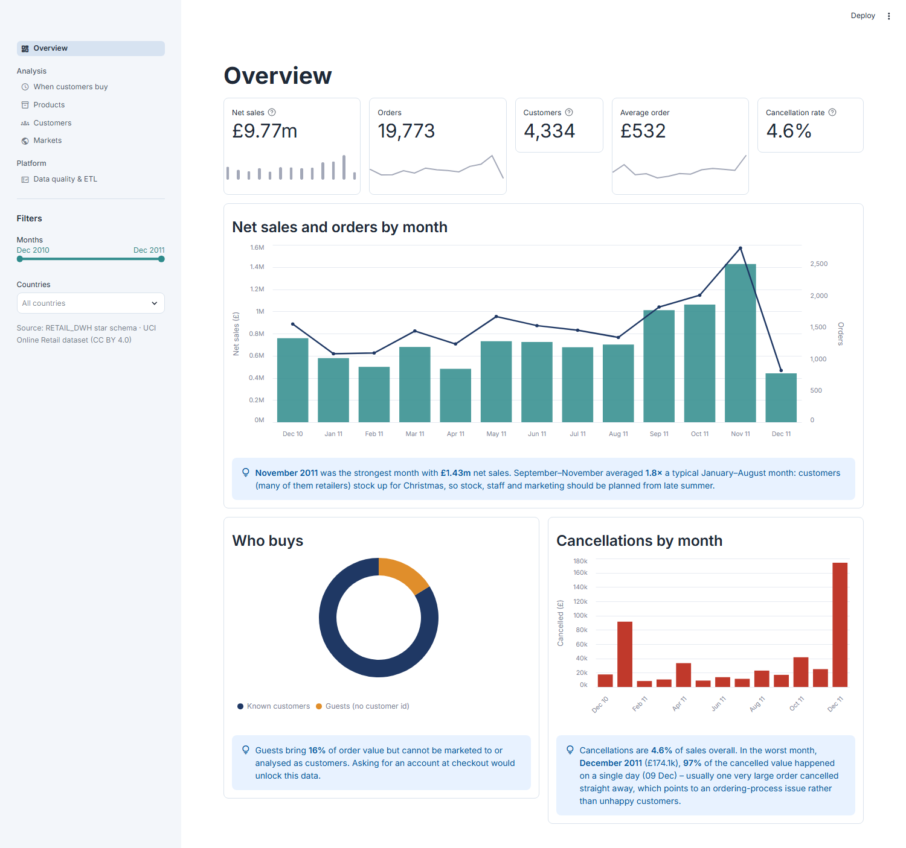

## Contents

1. [The process](#1-the-process)
2. [One run, step by step](#2-one-run-step-by-step)
3. [How a file is loaded](#3-how-a-file-is-loaded)
4. [Slowly changing dimensions (SCD type 2)](#4-slowly-changing-dimensions-scd-type-2)
5. [The data warehouse (star schema)](#5-the-data-warehouse-star-schema)
6. [All database objects and timestamps](#6-all-database-objects-and-timestamps)
7. [Cleaning rules](#7-cleaning-rules)
8. [Deletes – what we do now and what we advise](#8-deletes--what-we-do-now-and-what-we-advise)
9. [Business questions](#9-business-questions)
10. [Naming convention](#10-naming-convention)
11. [How to run](#11-how-to-run)
12. [Environments](#12-environments)
13. [Folders](#13-folders)
14. [In SSMS](#14-in-ssms)
15. [Tested](#15-tested)
16. [Interview Q&A – design, data quality, future](#16-interview-qa)
17. [Dashboard](#17-dashboard)

## 1. The process

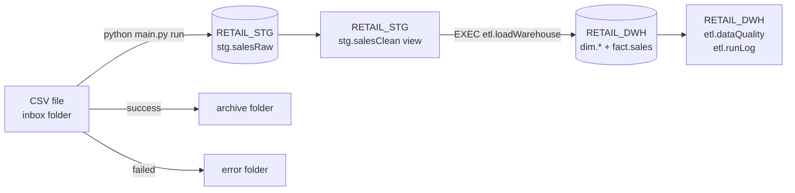

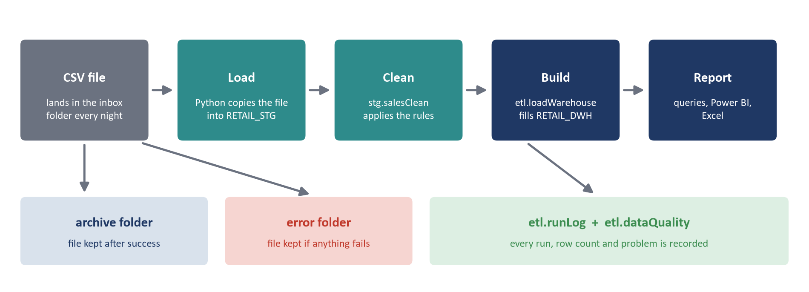

## 2. One run, step by step

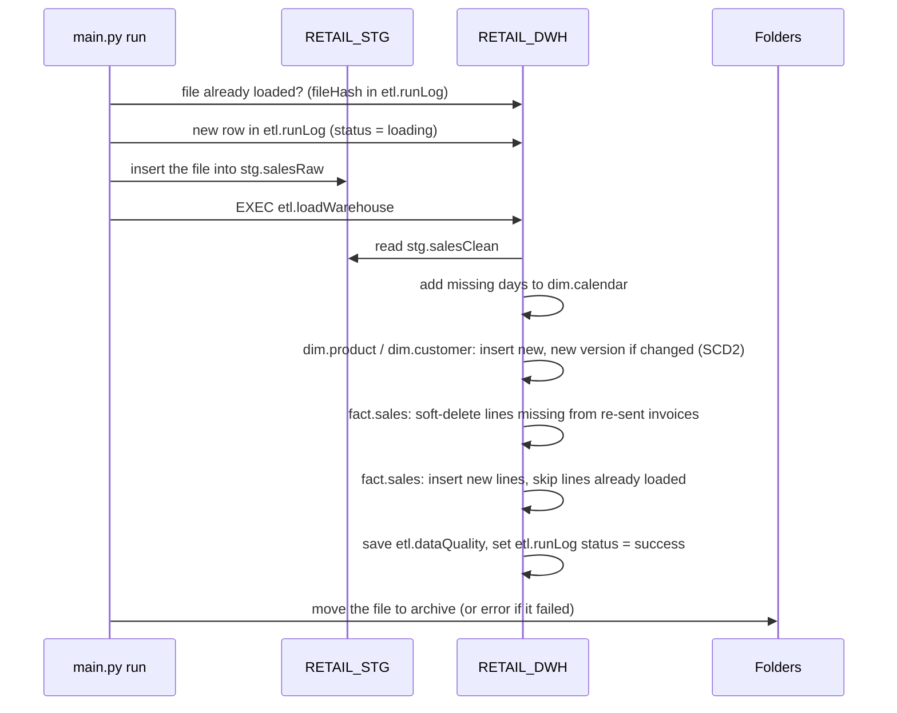

## 3. How a file is loaded

Each file is one run (`runId`). `RETAIL_DWH.etl.loadWarehouse @runId` loads only that file, and it never truncates or physically deletes anything.

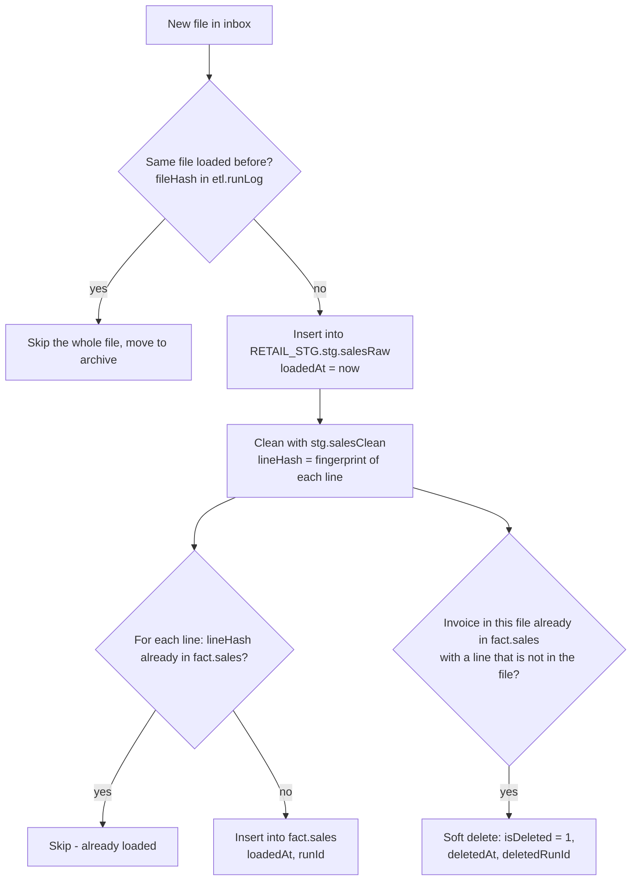

| Situation | What happens | Where you see it |
|---|---|---|
| New line | inserted | `etl.runLog.insertedRowCount` |
| Same line arrives again (in any file) | skipped | `etl.runLog.skippedRowCount` |
| Exactly the same file again | whole file skipped | console + archive |
| Invoice re-sent with a line changed | old line soft-deleted, new line inserted | `deletedRowCount` + `insertedRowCount` |
| Invoice re-sent with a line removed | that line soft-deleted | `etl.runLog.deletedRowCount` |
| Exact duplicate lines inside one file | second copy removed | `etl.dataQuality.duplicateRows` |

**Assumption:** a file always contains complete invoices. If an invoice appears in a file, that file holds the full, latest version of that invoice.

## 4. Slowly changing dimensions (SCD type 2)

`dim.product` and `dim.customer` keep history instead of overwriting it.

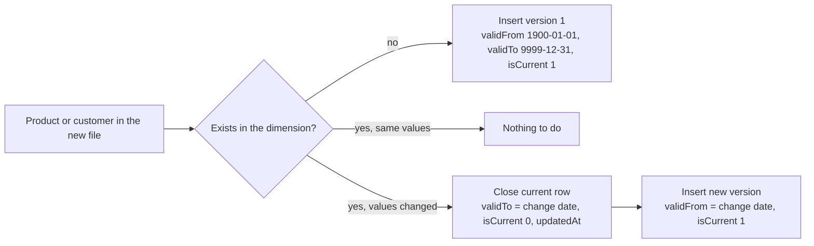

| Dimension | Business key | Tracked attributes (a change creates a new version) |
|---|---|---|
| `dim.product` | `stockCode` | `description`, `productType` |
| `dim.customer` | `customerId` | `country` |

- **Fact rows keep their history.** Each sales line points to the version that was valid on its invoice date. Old invoices keep the old product name and customer country; new invoices get the new version.
- **Junk descriptions are ignored.** Warehouse notes such as "damaged" or "?" on stock-adjustment lines can never create a new product version.
- **Two kinds of report:**
  - To report on the latest name or country, join to the row with `isCurrent = 1` (as Q1 and Q4 do).
  - To report on history, join on the key stored in `fact.sales`.

Tested example from the dev environment:

| productKey | stockCode | description | validFrom | validTo | isCurrent |
|---|---|---|---|---|---|
| 912 | 85123A | WHITE HANGING HEART T-LIGHT HOLDER | 1900-01-01 | 2011-12-10 09:00 | 0 |
| 3960 | 85123A | WHITE HANGING HEART T-LIGHT HOLDER LARGE | 2011-12-10 09:00 | 9999-12-31 | 1 |

## 5. The data warehouse (star schema)

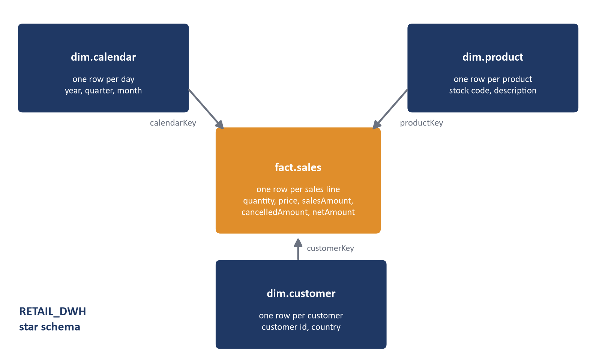

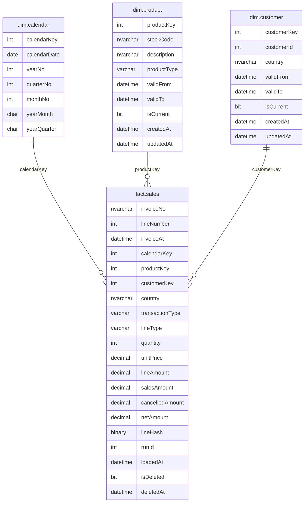

## 6. All database objects and timestamps

| Object | Type | Holds |
|---|---|---|
| `RETAIL_STG.stg.salesRaw` | table | every CSV file as received |
| `RETAIL_STG.stg.salesClean` | view | the same data, cleaned, with `lineHash` |
| `RETAIL_DWH.dim.calendar` | table | one row per day |
| `RETAIL_DWH.dim.product` | table | one row per product version (SCD type 2) |
| `RETAIL_DWH.dim.customer` | table | one row per customer version (SCD type 2, key 0 = guest) |
| `RETAIL_DWH.fact.sales` | table | one row per sales line (insert-only, soft deletes) |
| `RETAIL_DWH.etl.runLog` | table | one row per file: status, inserted / skipped / deleted counts, error |
| `RETAIL_DWH.etl.dataQuality` | table | what was removed or flagged in each run |
| `RETAIL_DWH.etl.loadWarehouse` | procedure | loads one file (runId) from staging into the warehouse |

| Table | Timestamp columns |
|---|---|
| `RETAIL_STG.stg.salesRaw` | `loadedAt` |
| `RETAIL_DWH.dim.calendar` | `loadedAt` |
| `RETAIL_DWH.dim.product`, `dim.customer` | `createdAt`, `updatedAt` (when the version was closed), `validFrom`, `validTo` |
| `RETAIL_DWH.fact.sales` | `loadedAt`, `deletedAt` (+ `runId`, `deletedRunId`) |
| `RETAIL_DWH.etl.runLog` | `startedAt`, `finishedAt` |
| `RETAIL_DWH.etl.dataQuality` | `checkedAt` |

## 7. Cleaning rules

All rules are in the view `RETAIL_STG.stg.salesClean` (`sql/2_staging.sql`).

| Problem in the data | What happens | Rows (full file) |
|---|---|---|
| Exact duplicate lines | removed | 5,268 |
| Values that are not valid numbers/dates | removed | 0 |
| Missing CustomerID | kept as guest (customerKey 0) | 135,037 |
| Cancellations (invoice starts with C) | kept as `cancelledAmount` | 9,251 |
| Postage, fees, discounts, manual entries | kept, not in `salesAmount` | 2,940 |
| Price 0 and no customer ("damaged", "?") | kept as `stockAdjustment` | 2,459 |
| Very large quantities, negative prices | kept, listed for review | 7 |
| Extra spaces, lower case | trimmed and upper-cased | – |
| EIRE, RSA, USA, Unspecified | Ireland, South Africa, United States, Unknown | – |

Every run saves these counts, plus new and changed products and customers, in `RETAIL_DWH.etl.dataQuality`.

## 8. Deletes – what we do now and what we advise

**What the platform does today:**
- **Nothing is ever physically deleted.** Removed or changed lines are soft-deleted (`isDeleted = 1`) with the time and the run that removed them, so every change can be audited and undone.
- **A line removed from a re-sent invoice is detected and soft-deleted** (tested).
- **Cancellations are already handled as normal data.** The source records a cancelled order as a new `C` invoice with negative quantities, and the warehouse keeps it as `cancelledAmount`.

**What cannot be detected from daily files alone:** an invoice that is deleted in the source system and simply never sent again. A daily file only shows what is new, not what disappeared.

**Recommended next steps, simplest first:**

| Option | How it works | Effort |
|---|---|---|
| 1. Keep using cancellation invoices (recommended) | Ask the source team never to delete orders, only to cancel them with a `C` invoice. This is already supported. | none |
| 2. A small "deleted invoices" file | The source sends a list of deleted invoice numbers. A short procedure soft-deletes those invoices. | small |
| 3. Weekly full snapshot | Once a week the source sends all invoices of the last N days. Anything active in the warehouse but missing from the snapshot is soft-deleted. | medium |
| 4. Change data capture (CDC) | Read inserts, updates and deletes directly from the source database. | large |

**Other advice:**
- **Report active rows only.** Always filter `fact.sales` on `isDeleted = 0`; all the provided queries already do.
- **Review soft deletes.** Check `deletedRowCount` in `etl.runLog` each week. A sudden jump usually means the source sent an incomplete file.
- **Keep the archive folder.** The original files make it possible to replay any day.

## 9. Business questions

The results are in `output/report_dev.md` (`python main.py report`).

| # | Question | File |
|---|---|---|
| Q1 | Top 10 products last month | `sql/queries/1_top_products_last_month.sql` |
| Q2 | Countries with the most orders in Q4 2011 | `sql/queries/2_orders_by_country_q4_2011.sql` |
| Q3 | Average order value by month | `sql/queries/3_average_order_value_by_month.sql` |
| Q4 | Customers with more than 5 purchases | `sql/queries/4_customers_over_5_purchases.sql` |

The two category questions in the brief are not answered, because the data has no product category.

## 10. Naming convention

| Item | Rule | Example |
|---|---|---|
| Files and folders | lower case | `sql/2_staging.sql`, `etl/pipeline.py`, `readme.md` |
| Database | `RETAIL_` + layer, upper case | `RETAIL_STG`, `RETAIL_DWH` |
| Schema | the role of the objects, lower case | `stg`, `dim`, `fact`, `etl` |
| Table / view / procedure | camelCase | `stg.salesRaw`, `fact.sales`, `etl.loadWarehouse` |
| Column | camelCase, same name in every layer | `invoiceNo`, `stockCode`, `customerId` |
| Reference in SQL | always `DATABASE.schema.object` | `RETAIL_DWH.fact.sales` |
| Surrogate key | ends with `Key` | `productKey`, `calendarKey` |
| Money | ends with `Amount` | `salesAmount`, `netAmount` |
| Counts | ends with `Count` | `fileRowCount` |
| Flags | starts with `is` | `isDuplicate`, `isDeleted` |
| Timestamps | ends with `At` | `loadedAt`, `deletedAt` |
| SCD type 2 columns | `validFrom`, `validTo`, `isCurrent` | `dim.product`, `dim.customer` |
| Primary key | `pk` + table | `pkSales` |
| Python | camelCase variables and functions | `processFile`, `filePath`, `runId` |

## 11. How to run

```powershell
pip install -r requirements.txt
python main.py setup      # once: creates RETAIL_STG, RETAIL_DWH, tables, view, procedure
python main.py extract    # downloads the source CSV into the inbox
python main.py run        # inbox -> RETAIL_STG -> RETAIL_DWH -> archive
python main.py report     # results -> output/report_dev.md
streamlit run dashboard/streamlit_app.py   # dashboard -> http://localhost:8501
```

**Every day:**
1. Put the new CSV in `data/dev/inbox/`.
2. Run `python main.py run`.

## 12. Environments

Settings are in the `.config` folder. The database names are the same in every environment; only the server changes.

| File | Contents |
|---|---|
| `settings.env` | `ENVIRONMENT=dev`, which picks the environment |
| `dev.env` | server `GHOST`, login, folders `data/dev/` |
| `prod.env` | production server (set `SQL_SERVER`), login, folders `data/prod/` |
| `example.env` | template for a new environment |

**To switch:**
- Set `ENVIRONMENT=prod` in `settings.env`, or
- Add `--env prod` to a command.

**Login:** `SQL_LOGIN=windows` uses your Windows login, so no password is stored.

## 13. Folders

```
.config/          environment settings
main.py           the 4 commands
etl/settings.py   reads .config
etl/pipeline.py   setup, extract, run, report
sql/              1_databases, 2_staging, 3_warehouse, 4_load_warehouse
sql/queries/      the 4 business questions
website/          index.html – one-page project website (charts, screenshots, light/dark theme)
dashboard/        Streamlit dashboard: streamlit_app.py, data.py, app_pages/ (6 pages), .streamlit/config.toml
docs/             retail_data_platform_report.docx (stakeholder report), brief/, images/ (screenshots and diagrams)
skills.md         guide for AI assistants working on this project
data/dev/         inbox, archive, error
output/           report per environment
```

## 14. In SSMS

```sql
SELECT * FROM RETAIL_DWH.etl.runLog ORDER BY runId DESC;   -- runs
SELECT * FROM RETAIL_DWH.etl.dataQuality;                   -- data quality
SELECT * FROM RETAIL_DWH.dim.product WHERE stockCode = '85123A' ORDER BY validFrom;   -- SCD2 history
SELECT * FROM RETAIL_DWH.fact.sales WHERE isDeleted = 1;    -- soft-deleted lines
EXEC RETAIL_DWH.etl.loadWarehouse @runId = 1;               -- re-run a file by hand (safe: loaded lines are skipped)
```

## 15. Tested

| Test | Result |
|---|---|
| Full file (541,909 rows) | 536,641 new lines, net sales £9,771,318.16, in about 28 seconds |
| Empty inbox | nothing happens |
| Exactly the same file again | whole file skipped and archived |
| Same invoices in a different file | 0 new, 9 already loaded, 0 soft-deleted |
| Corrected invoice (one quantity changed, one line removed) | 1 new, 5 already loaded, 2 soft-deleted |
| Customer moved country + product renamed | new SCD2 versions; old invoices keep the old version, new invoices use the new one |
| Re-run a file by hand (`EXEC ... @runId`) | 0 new, all skipped |
| File with missing columns | moved to `error/`, logged as failed |

## 16. Interview Q&A

Answers to every question in part 3 of the brief, in the brief's order.

### Design decisions

**1. How did you structure your data models? Why?**

| Layer | Objects | Why |
|---|---|---|
| Staging database `RETAIL_STG` | `stg.salesRaw` (file as received), `stg.salesClean` (view with all cleaning rules) | The raw file is kept exactly as delivered, so any day can be audited or reloaded. All cleaning sits in one view, so there is one place to read and change the rules. |
| Data warehouse `RETAIL_DWH` | star schema: `fact.sales` + `dim.calendar`, `dim.product`, `dim.customer` | A star schema is the standard shape for reporting: questions become short joins (see `sql/queries/`), and it plugs straight into Power BI or Excel. |
| ETL tracking `RETAIL_DWH.etl` | `etl.runLog`, `etl.dataQuality`, `etl.loadWarehouse` | Every run and every data problem is recorded, so the pipeline can be monitored and trusted. |

Two more choices:
- **Python only moves files; all logic is in SQL.** SQL Server is where the data lives, and the stored procedure runs each load as one transaction, so a failure never leaves half-loaded data.
- **Kept deliberately small:** seven tables and one view. This makes the platform easy to explain, hand over and maintain.

**2. What grain did you choose for each table?**

| Table | Grain (one row = …) | Key |
|---|---|---|
| `RETAIL_STG.stg.salesRaw` | one line of one delivered file | `runId` + `lineNumber` |
| `RETAIL_DWH.fact.sales` | one sales line (an invoice line) | `salesKey`; `lineHash` is unique among active rows |
| `RETAIL_DWH.dim.calendar` | one day | `calendarKey` (YYYYMMDD) |
| `RETAIL_DWH.dim.product` | one version of a product (SCD type 2) | `productKey`; business key `stockCode` |
| `RETAIL_DWH.dim.customer` | one version of a customer (SCD type 2); key 0 = guest | `customerKey`; business key `customerId` |
| `RETAIL_DWH.etl.runLog` | one processed file | `runId` |
| `RETAIL_DWH.etl.dataQuality` | one check in one run | `runId` + `checkName` |

The fact table uses the lowest level available, the invoice line, so any summary can be built from it: orders, customers, products, days or countries.

**3. How do your models enable incremental loads?**

- **One file = one run.** `etl.loadWarehouse @runId` processes only that file's rows. Nothing is truncated or rebuilt.
- **File level:** the file's SHA-256 hash is stored in `etl.runLog`, so the same file is never loaded twice.
- **Line level:** every cleaned line gets a `lineHash` fingerprint. A line already in `fact.sales` is skipped, so the same data in a *different* file is also never double-counted.
- **Dimensions:**
  - New products and customers are inserted.
  - Changed ones get a new SCD2 version; unchanged ones are left alone.
  - Missing calendar days are added.
- **Safe to re-run:** running the same file again inserts nothing (tested: 0 new, all skipped).
- **Lineage:** every fact row has `runId` and `loadedAt`, so each row can be traced to its file and load time.

**4. What changes would be needed if this data started landing every hour / minute / second?**

| Frequency | What changes |
|---|---|
| **Every hour** | Nothing in the design. Schedule `python main.py run` hourly (SQL Server Agent, Task Scheduler or Azure Data Factory). Each run only handles its own small file. |
| **Every minute** | Micro-batches:<br>- trigger on file arrival (Data Factory event trigger) instead of a clock;<br>- load staging with `BULK INSERT` instead of row inserts;<br>- let one procedure call process several waiting files;<br>- clear processed rows from `stg.salesRaw` (the original files stay in the archive);<br>- refresh dashboards every few minutes, not on every file. |
| **Every second** | Streaming instead of files:<br>- the sales system publishes events to Event Hubs or Kafka (or SQL Server change data capture);<br>- a stream job (Azure Stream Analytics or Spark) cleans and de-duplicates events using the same rules and the `lineHash` idea;<br>- events are appended to a staging table, and `fact.sales` is merged every 1–5 minutes;<br>- live KPIs read from the stream, while the warehouse remains the full, trusted history. |

### Data quality handling

**5. What data quality issues did you find?**

| Issue | Rows (full file) |
|---|---|
| Lines with no customer number | 135,037 (25%) |
| Cancellations (invoice starts with C, negative quantity) | 9,251 |
| Exact duplicate lines | 5,268 |
| Postage, fees, discounts, manual entries, samples, gift vouchers (not products) | 2,940 |
| Zero price and no customer: warehouse notes such as "damaged", "?", "check" | 2,459 |
| Very large quantities (10,000+, each cancelled the same day) | 5 |
| Negative prices (bad-debt write-offs) | 2 |
| Values that are not valid numbers or dates | 0 |
| Extra spaces and mixed case in descriptions; lower-case stock codes | ~131,000 |
| Old country codes: EIRE, RSA, USA, Unspecified | ~8,700 |
| Same stock code with several descriptions | 638 codes |
| Customers seen in two countries | 8 |

**6. How did you handle them? Why those approaches?**

- **Keep the original, flag the problem.** Raw rows are never changed. The cleaning view adds flags (`isDuplicate`, `isInvalid`) and labels (`lineType`, `transactionType`). Every rule is visible in one place and can be changed and replayed.
- **Remove only what is certainly wrong.** Exact duplicates and rows that can't be converted to numbers or dates are removed. Anything else could be a real sale, so it is kept and labelled. No sale is silently lost.
- **Separate, don't mix.** Cancellations are kept as `cancelledAmount`; postage and fees are not counted as product sales; stock notes are not sales. Gross, cancelled and net sales are therefore each correct.
- **Guests are kept** as `customerKey = 0`. Their sales still count, but they never distort customer analysis.
- **Duplicates are found with a hash of the whole line.** The server collation is case-insensitive, so comparing column values would wrongly treat "Bag" and "BAG" as the same line.
- **Every run counts every issue** in `etl.dataQuality`, so trends and spikes are visible.

**7. What issues did you surface vs. correct?**

| Corrected (changed automatically) | Surfaced (kept, labelled and counted for people to review) |
|---|---|
| Exact duplicate lines – removed | Missing customer numbers – guest, `guestRows` |
| Unreadable numbers / dates – removed | Cancellations – `cancelledAmount`, `cancellations` |
| Extra spaces, upper/lower case – standardised | Very large quantities – `largeQuantities` |
| Country codes – Ireland, South Africa, United States, Unknown | Negative prices – `negativePrices` |
| Stock code case (85123a = 85123A) | Postage / fees / discounts – `nonProductRows` |
| Text converted to numbers and dates | Stock notes ("damaged", "?") – `stockAdjustments` |
| Product name – most used description chosen | Lines removed from a re-sent invoice – soft-deleted, `deletedRowCount` |
| | Product / customer changes – SCD2 versions, `changedProducts`, `changedCustomers` |

**The rule:** correct only what has one obviously right answer; surface anything that needs a business decision.

**8. What assumptions did you make?**

- A file contains **complete invoices**. If an invoice appears in a newer file, that file has its full, latest version.
- **Exact duplicate lines** in a file are recording errors, not two separate purchases.
- **Revenue** = quantity × unit price, in GBP. A **cancellation** counts in the month it happens.
- **Zero price and no customer** is a warehouse note, not a sale.
- Invoices starting with **C** are cancellations and those starting with **A** are adjustments.
- An **order** is a sale invoice with product sales above zero.
- **"Last month"** = November 2011, the last full month in the data.
- There is **no product category** in the data, so the two category questions were not answered rather than guessed.

### Future considerations

**9. What would you do differently with more time?**

- **Automated tests** for the SQL (tSQLt) and the Python, run in **CI/CD** with GitHub Actions on every change.
- **Product categories** from a product master, to answer the two category questions.
- **Link each cancellation to its original order** for true return rates per product.
- A **quarantine table** for rejected rows, so they can be fixed and re-loaded instead of only counted.
- **Several SCD2 changes inside one file** (today a file produces at most one new version per product or customer).
- A **data contract** with the source team: column list, complete invoices, no hard deletes.
- A **Power BI semantic model** on `RETAIL_DWH` for self-service reporting.

**10. How would this design scale to millions of daily rows?**

The incremental design already scales; the changes are mostly about speed:
- **Faster loading:** `BULK INSERT` / bcp or Data Factory copy into staging. Python row inserts take about 10 s per 540k rows today.
- **Bigger fact table:** partition `fact.sales` by month and add a **clustered columnstore index** for fast, compressed reporting.
- **Lean staging:** remove processed rows from `stg.salesRaw` after a successful run, since the original files stay in the archive. The cleaning view then only reads today's data.
- **Indexes already in place:** the SCD2 lookups (`stockCode` / `customerId` + `validFrom`) and the duplicate check (`lineHash`) are indexed.
- **Bigger platform when needed:** Azure SQL Hyperscale, or Microsoft Fabric / Synapse, using the same model and SQL.

**11. What monitoring or alerts would you implement?**

| Alert | Rule | Source |
|---|---|---|
| Run failed | `status = 'failed'` | `etl.runLog` |
| File missing | no successful run by 03:00 | `etl.runLog.startedAt` |
| Run too slow | duration more than 2× the 7-day average | `startedAt`, `finishedAt` |
| Volume change | `fileRowCount` ±50% vs the 7-day average | `etl.runLog` |
| Bad rows | `invalidRows` > 0 | `etl.dataQuality` |
| Data drift | `duplicateRows` > 3% or `guestRows` > 35% of the file | `etl.dataQuality` |
| Unusual deletes | `deletedRowCount` spike (usually an incomplete file) | `etl.runLog` |
| Rejected file | any file in the `error` folder | folder check |

- **On the current server:** a SQL Server Agent job checks these queries after each run and sends an email with Database Mail.
- **On Azure:** Azure Monitor alerts by email or Microsoft Teams.
- **On the dashboard:** the "Data quality & ETL" page shows the same information.

**12. How would you handle late-arriving corrections?**

- **Corrected invoice re-sent:** the newest version wins. Changed or removed lines are soft-deleted (`isDeleted`, `deletedAt`, `deletedRunId`), and the corrected lines are inserted. Tested: 1 new, 5 skipped, 2 soft-deleted.
- **Old sales arriving late:** they are inserted with their real `invoiceDate`, so they appear in the right month. Each line also links to the product and customer *version that was valid on that date* (SCD2 lookup on `validFrom`).
- **Closed months that must not move** (e.g. after month-end reporting): `loadedAt` and `deletedAt` make it possible to report numbers "as of" a date. The next step would be a monthly snapshot table, so any late change shows up as a visible adjustment.
- **Orders deleted at the source:** see [section 8](#8-deletes--what-we-do-now-and-what-we-advise). Today cancellations arrive as `C` invoices; for real deletes, a daily "deleted invoices" file is the simplest fix.

**Automating it in the cloud:** the same process can run hands-off on Microsoft Azure (details in the stakeholder report, section 8).

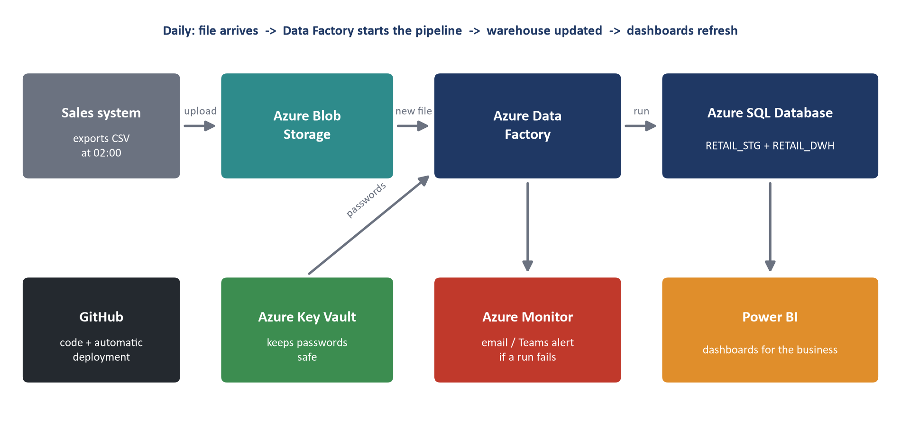

## 17. Dashboard

An interactive website built with Streamlit on top of `RETAIL_DWH`. Start it from the project folder:

```powershell
streamlit run dashboard/streamlit_app.py      # opens http://localhost:8501
```

- **Filters:** the sidebar filters (month range, countries) apply to every page.
- **Analysis notes:** every chart has a note underneath, calculated from the data, so it stays correct when the filters change.
- **Theme:** the same navy / teal colours as the stakeholder report.

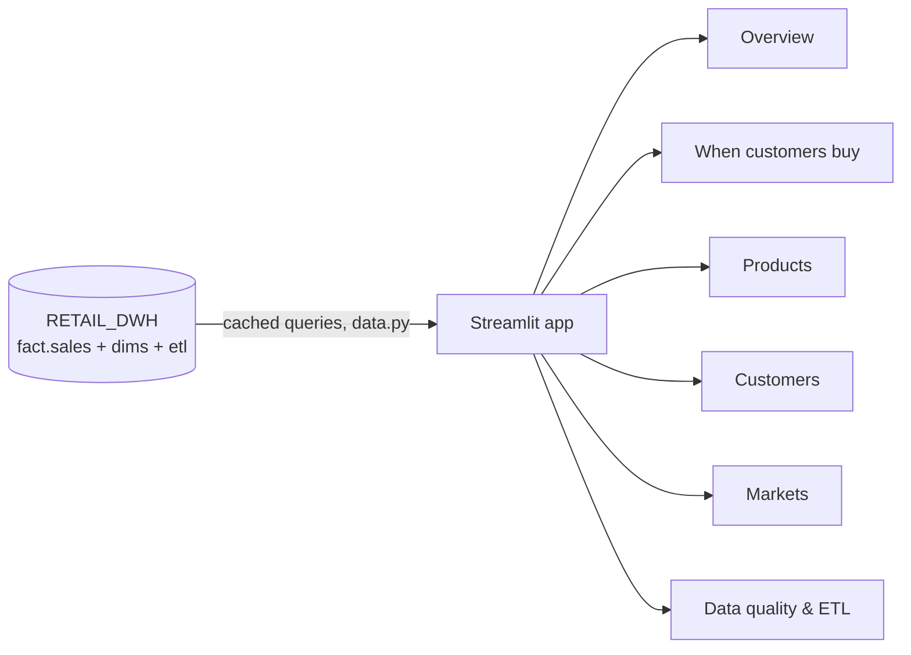

| Page | Visuals | What it answers |
|---|---|---|
| Overview | KPI cards with sparklines, monthly sales + orders, guests vs known customers, cancellations by month | How is the business doing overall? |
| When customers buy | day × hour heatmap, daily sales with 7-day average, order value by weekday | When should we staff up and run promotions? |
| Products | top products, Pareto (80/20) curve, most cancelled products, rising stars with trend sparklines | Which products matter most and which are growing? |
| Customers | RFM segments (Champions, Loyal, At risk, ...), monthly cohort retention heatmap, top customers (net of cancellations) | Who are our best customers and do new ones come back? |
| Markets | sales by country (UK on/off), order size vs number of orders bubble chart, market table | Where should we grow outside the UK? |
| Data quality & ETL | run status, data-quality checks, ETL run log, soft deletes and SCD2 versions | Can we trust the data, and did last night's load work? |

### Screenshots

**Overview** – KPIs, monthly trend, who buys, cancellations


**When customers buy** – day × hour heatmap, daily sales, order value by weekday

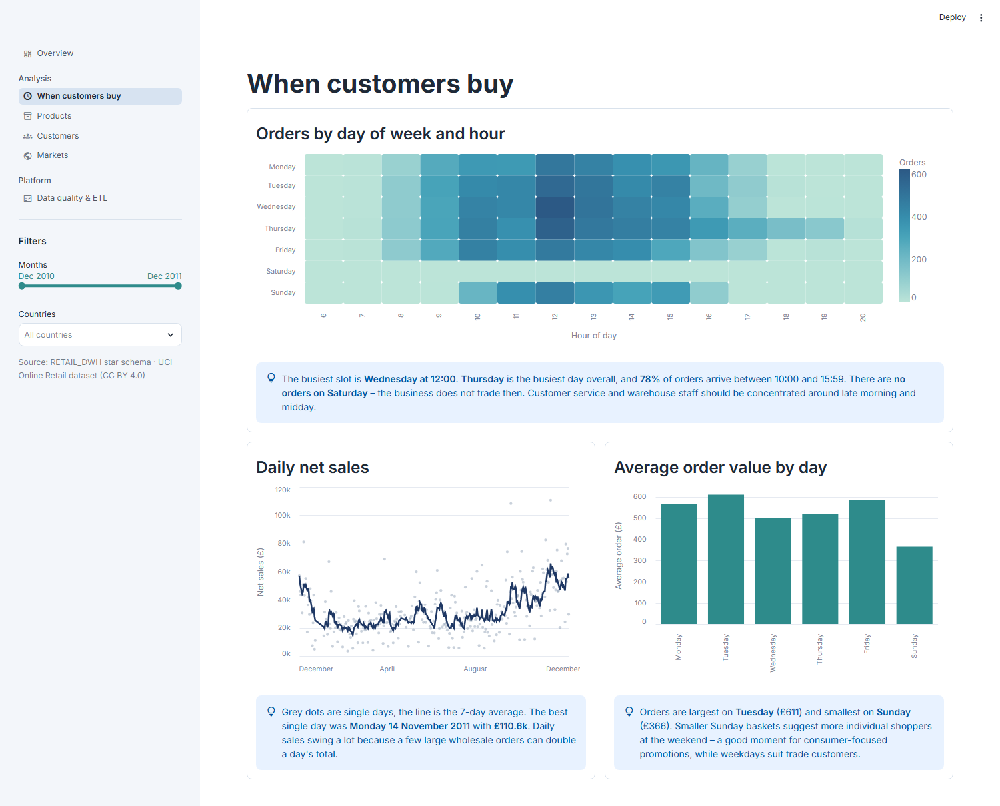

**Products** – best sellers, 80/20 curve, most cancelled, rising stars

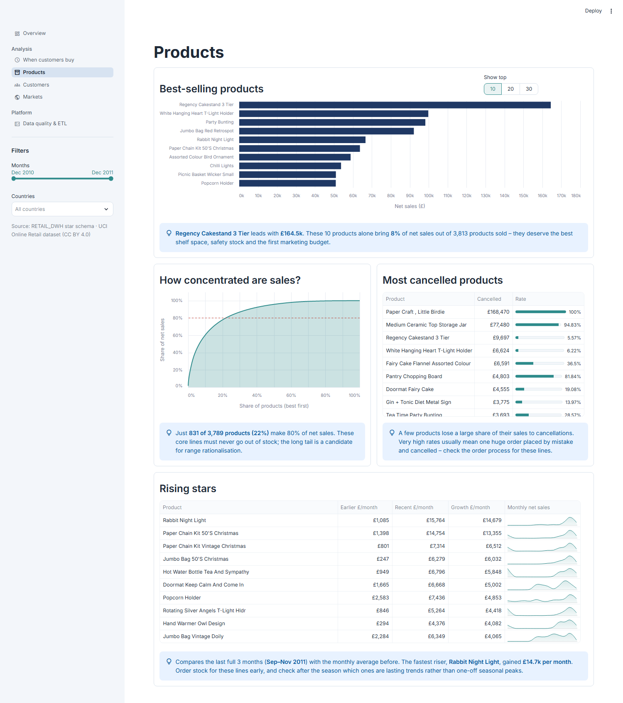

**Customers** – segments, cohort retention, top customers (net of cancellations)

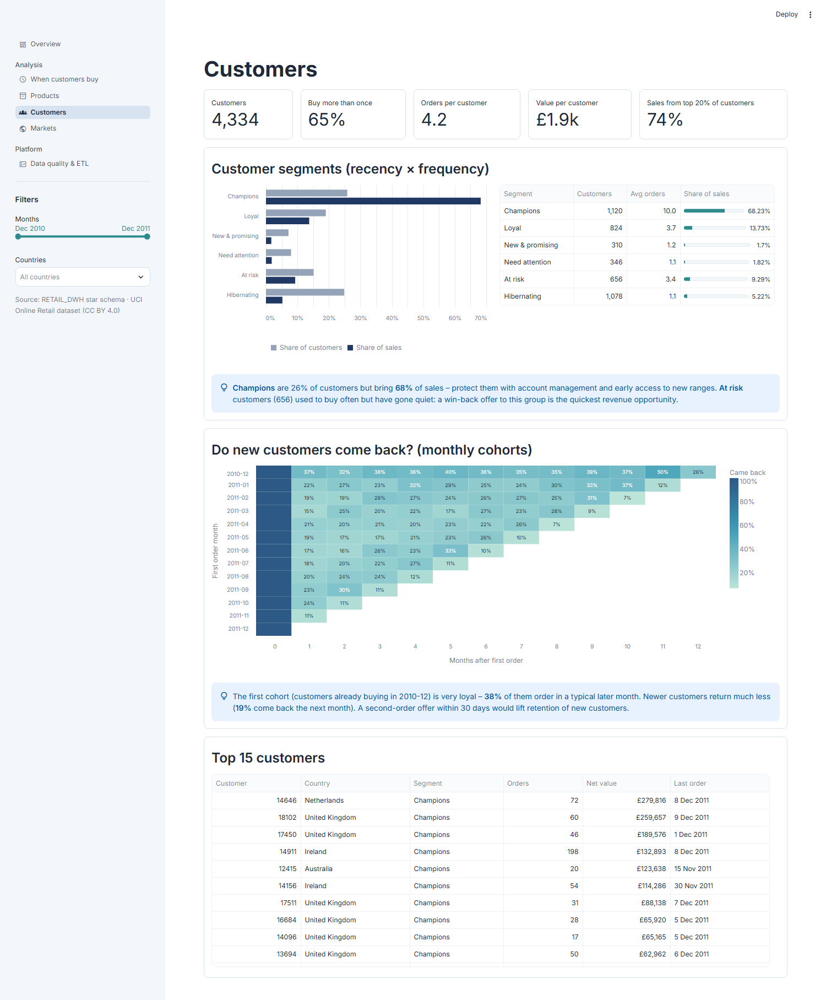

**Markets** – sales by country, order size vs number of orders

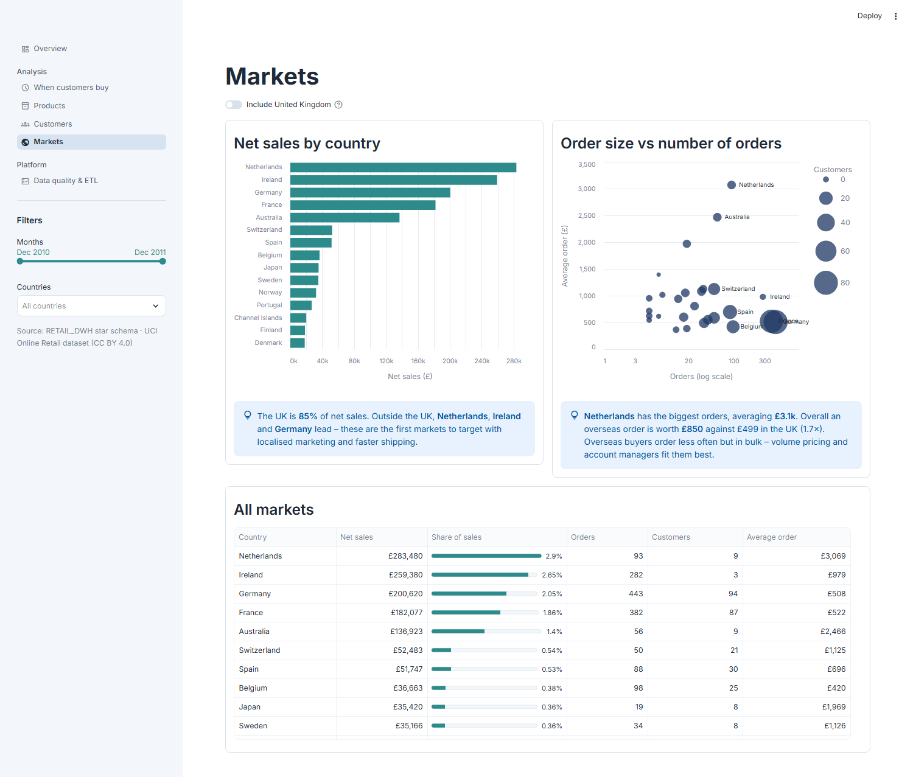

**Data quality & ETL** – run status, data-quality checks, run log

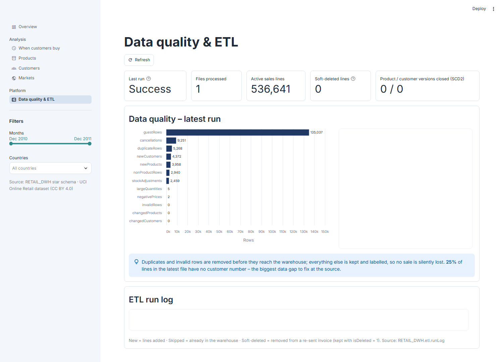

### Key charts

| Net sales by month | Share of net sales by country |
|---|---|
| 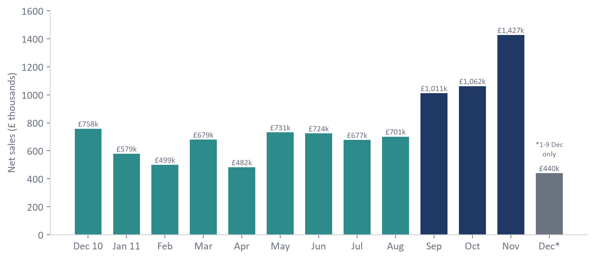 | 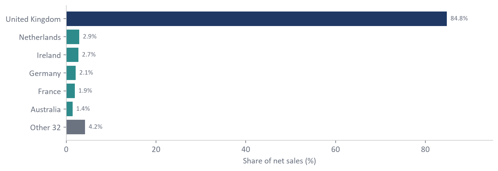 |

**Key findings (full period, all countries):**

| Finding | Number | Suggested action |
|---|---|---|
| Christmas peak | Sep–Nov sales are **1.8×** a normal month; Nov 2011 = **£1.43m** | plan stock, staff and marketing from late summer |
| Strong weekday pattern | **no orders on Saturdays**; **78%** of orders arrive 10:00–15:59; Thursday is busiest | staff customer service and the warehouse around midday |
| Sales are concentrated | **831 of 3,789 products (22%)** make 80% of sales | never let these run out of stock; review the long tail |
| Loyal customers carry the business | **Champions** are 26% of customers and bring **68%** of sales; **656** good customers are "at risk" | account management for Champions, win-back offer for "at risk" |
| New customers rarely return | only **19%** of new customers order again the next month | send a second-order offer within 30 days |
| Overseas orders are bigger | an overseas order averages **£850** vs **£499** in the UK; Netherlands **£3.1k** | volume pricing and account managers for overseas buyers |
| Cancellations are one-off events | **97%** of December 2011's cancelled value was a single day | review the ordering process for very large orders |
| Data gap | **25%** of lines have no customer number | ask the sales system to always capture the customer |

